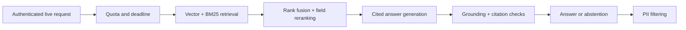

# Telecom GenAI Platform

Release 1.2.0 is a runnable telecom knowledge assistant and LLMOps case study.
It includes a credential-free local demo, a protected live RAG endpoint,
versioned datasets, reproducible retrieval evaluation, request tracing, and
tests against real PostgreSQL transactions and retrieval. The deployment release
adds TLS, mounted secrets, immutable image publication, backup/restore tooling,
conversation deletion/retention and validated Azure infrastructure.

The [roadmap completion record](docs/roadmap-1.2.md) documents the locally tested
identity/ACLs, approvals, migrations, durable jobs, runtime-path evaluation and
rollback checks, and separates them from external production acceptance.

See [deployment and rollback](docs/deployment.md) for the supported production
topology, release gates and operator inputs. Real-provider quality and remaining
unfixed OS advisories require acceptance before a real production rollout.

## Run the delivered demo

```sh
docker compose up -d --build demo
```

Open [the demo](http://127.0.0.1:8000/demo) or [interactive documentation](http://127.0.0.1:8000/docs).
No `.env` or external model account is required. The container runs as a
non-root user with a read-only filesystem and binds to localhost.

The demo retrieves historical facts from 50 synthetic tickets and extracts
their summary, root cause, resolution, and runbook. It does not read golden
reference answers or call an LLM. Unknown questions can return an abstention.
Scores express retrieval heuristics, not calibrated probabilities.

For native development, install [uv](https://docs.astral.sh/uv/), then:

```sh
uv sync --locked --extra dev --python 3.11
uv run uvicorn src.api.main:app --host 127.0.0.1 --port 8000
```

## Scope and operating modes

| Mode | Purpose | Dependencies |
|---|---|---|
| `demo` (default) | Extract facts from synthetic historical incidents | Packaged dataset only |
| `live` | Generate cited answers from an operator-published PostgreSQL snapshot | PostgreSQL, configured OpenAI key |

Bearer mode remains one trusted operator with separate reader/admin credentials.
OIDC mode validates signed access tokens, roles, tenants and groups; retrieval
and conversation memory enforce server-side access boundaries. Its issuer/JWKS
integration is tested locally, not against a receiving enterprise account.
The explicit two-person action workflow executes only a local ledger simulation;
real OSS/BSS actions remain disabled and require an organization-specific adapter.
The Chroma adapter is an optional legacy extra excluded from the default install
due to known unpatched advisories. Worker/simulator Dockerfiles remain historical
scaffolding. Azure Terraform now targets the supported API and private PostgreSQL;
its mocked plans are tested, but no subscription-specific deployment is claimed.

See [the operating runbook](docs/operations.md) for live setup, index
publication, backup, recovery, and the release acceptance checklist.

## Request path



Dependencies belong to the application lifespan, with startup validation,
dependency-aware readiness and shutdown cleanup. Conversation turns use a
bounded PostgreSQL pool, run blocking work off the event loop, save complete
turns transactionally, and select recent history in chronological order.
Live tool requests escalate without executing simulated operations.

## Measured retrieval experiment

The golden set contains 50 synthetic questions with expected ticket IDs,
sources and reference answers.

| Configuration | Recall@1 | Recall@5 | Recall@10 | MRR |
|---|---:|---:|---:|---:|
| A: recursive chunks + hashing vector | 64% | 78% | 80% | 0.690 |
| B: ticket-aware chunks + hashing vector + BM25 | 74% | 86% | 96% | 0.796 |
| C: B + deterministic field reranker | 100% | 100% | 100% | 1.000 |

These are local synthetic experiment results. The vector baseline uses TF-IDF
feature hashing and deliberately excludes certain identifiers and acronyms.
Changing both chunking and retrieval does not isolate either change's causal
effect. The result does not establish neural embedding quality, generated
answer accuracy, or performance on real tickets. Live retrieval shares BM25
and field-ranking code but uses the configured embedding provider. Live
retrieval is bounded to 10,000 chunks and 2,000,000 embedding scalars; larger collections require a
dedicated search backend. Full methodology: [evaluation](docs/evaluation.md).

```sh
uv run python -m src.evaluation.cli --output reports/evaluation/latest.json --compare-to reports/evaluation/baseline.json
```

## Dataset lineage

```text
tickets-v1.0
  -> tickets-v1.1-cleaned
  -> tickets-v1.2-pii-redacted
  -> tickets-v2.0-ticket-aware-chunking
```

Every version includes a manifest with source snapshot, parent, hash, cleaning
rules, chunking, embedding model/dimensions, counts, timestamp, and evaluation
status. See [dataset versioning](docs/dataset-versioning.md).

## Tracing and verification

OpenTelemetry records entity extraction, vector search, keyword search, fusion,
reranking, prompt construction, model execution, grounding and final response.
Query content capture is **off by default**. The demo explicitly marks the LLM
stage as skipped. See [tracing](docs/tracing.md).

```sh
uv run ruff check src tests scripts
uv run mypy src --ignore-missing-imports
uv run pytest -q
docker compose --profile integration up -d --wait postgres redis
# Set RUN_INTEGRATION=1 in your shell, then:
uv run pytest tests/test_release.py -q
uv run python scripts/verify_release.py
uv build
```

CI verifies lint, types, tests, golden retrieval, Python distributions, real
PostgreSQL publication and retrieval, and an HTTP smoke test of the Docker demo.
It uploads release artifacts without deploying or publishing them.

## Endpoints

| Endpoint | Contract |
|---|---|
| `GET /health` | Process liveness |
| `GET /ready` | Dependency readiness; 503 when unavailable |
| `GET /demo` | Local demo interface; unavailable in live mode |
| `POST /api/v1/demo/chat` | Extractive synthetic ticket answers |
| `POST /api/v1/chat` | Live RAG; reader credential required |
| `GET /metrics` | Prometheus; protected in live mode |
| `POST /api/v1/ingest*` | HTTP ingestion disabled; operator CLI required |

## Interview walkthrough

I built a telecom knowledge assistant around inconsistent tickets, runbooks,
SLA documents and network configurations. Document-specific chunking preserves
incident identity, while vector and exact-term retrieval handle different
types of questions. I introduced a synthetic golden dataset, measured ranking
experiments, version manifests and request traces, then added explicit runtime
lifecycle, admission controls and answer abstention. The next external
validation is an approved real-ticket pilot using the deployed model path.

MIT license. Author: Marius Miclau.
